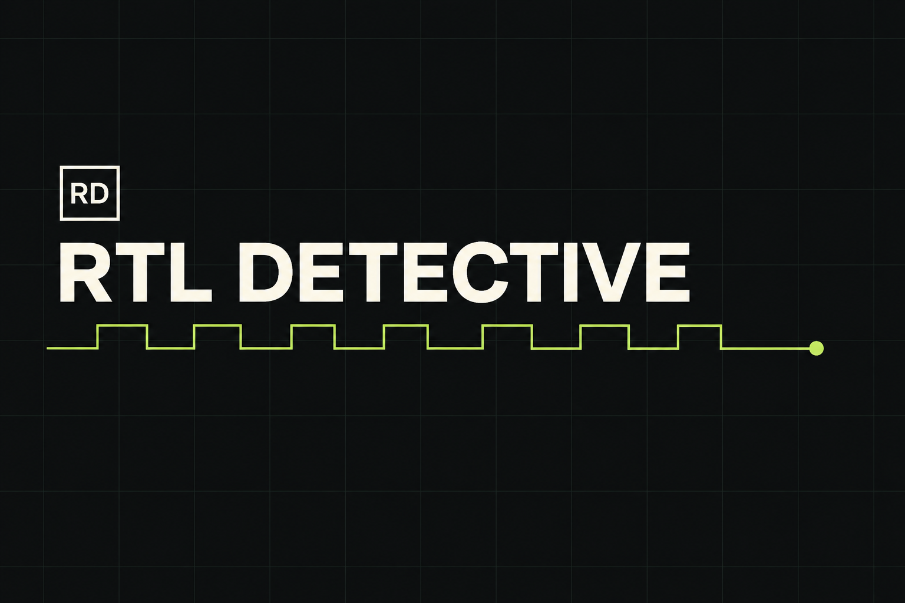
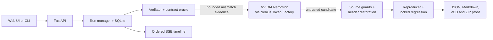

# RTL Detective

### Proof-carrying SystemVerilog repair with NVIDIA Nemotron and Verilator

[](https://github.com/JoelObinnaEze/rtl-detective/actions/workflows/ci.yml)
[](LICENSE)
[](pyproject.toml)

**[Live demo](https://rtl-detective.onrender.com)** · **[2:26 demo video](https://youtu.be/UmpgmuvtHXg)** · **[Evaluation record](docs/EVALUATION.md)**



RTL Detective is an evidence-first agent for debugging canonical, single-clock SystemVerilog blocks. NVIDIA Nemotron investigates a cycle-level failure and proposes a repair; a deterministic host then decides whether that repair is credible by rebuilding the design, replaying the failure, running a locked regression, and checking that the verification assets did not change.

The model is an **untrusted proposer**, not the authority. Every run ends with a bounded claim such as `candidate_passed_listed_tests`, `no_failure_found_in_tested_cases`, or `repair_not_verified`—never a claim of formal proof.

> The public demo runs on Render's free tier and can take about 50 seconds to wake after inactivity.

## What this demonstrates

- **Agent design with an explicit trust boundary:** the model receives bounded failure evidence and DUT source, but never the API key, oracle, locked tests, or expected patch.
- **Real HDL execution:** Verilator compiles the candidate and emits cycle observations plus a VCD trace; executable FIFO and arbiter oracles identify the first mismatch.
- **Defense in depth:** the host restores the locked module header, rejects unsafe or out-of-scope source, hashes verification assets, and verifies the candidate independently.
- **Operational engineering:** FastAPI, server-sent events, a bounded run queue, cancellation, SQLite persistence, restart recovery, and portable proof bundles support both the web UI and CLI.
- **Reproducible evaluation:** ten opaque benchmark cases, a 54-run FIFO parameter matrix, pinned dependencies, a digest-pinned Verilator image, and CI that builds and tests the judge container.

## Measured results

These are bounded results for the supported contracts—not a repair-rate benchmark or formal verification claim.

| Evaluation | Result |
|---|---:|
| Hidden-label FIFO + arbiter benchmark | **10/10** expected outcomes |
| FIFO parameter matrix | **18/18** configurations |
| Recorded matrix seeds | **54/54** seed/configuration runs |
| Hardened live Nemotron repair | **2** model requests, **2,472** tokens |
| Saved reproducer | **8/8** transactions passed |
| Independent locked regression | **80/80** transactions passed |
| Locked oracle/test/restriction assets | **Unchanged** |

The live run used Nebius Token Factory with `nvidia/nemotron-3-super-120b-a12b`. Its investigation and patch requests took 1,867 ms and 3,214 ms. The full run record, interpretation, hashes, and limits are in [docs/EVALUATION.md](docs/EVALUATION.md).

## Architecture



### Repair protocol

1. Select a contract pack, validate the canonical interface, preserve the original source, and hash the locked assets.
2. Compile the DUT with Verilator and compare every sampled cycle with the pack's executable oracle.
3. Send only the bounded failure evidence and untrusted DUT source to Nemotron using strict JSON-schema output.
4. Treat the response as hostile input: validate it, restore the original module header, and produce a canonical `dut.sv` diff.
5. Replay the saved reproducer, run an independently generated locked regression, and compare asset hashes.
6. Persist ordered events and export a portable `report.json`, `report.md`, and `artifact-bundle.zip`.

A repair claim requires all three host-controlled gates: the candidate passes the saved reproducer, passes the locked regression, and leaves every locked verification asset unchanged. Correct designs stop after the baseline and make no model call.

## Engineering decisions

| Decision | Why it exists |
|---|---|
| Contract packs instead of arbitrary RTL | Makes interface semantics explicit and gives each design a human-authored oracle and regression strategy. |
| Two bounded model calls | Caps cost and latency: one investigation, one candidate. Retries default to zero. |
| Full candidate source + canonical host diff | Avoids applying model-generated paths or patch metadata while preserving a reviewable change. |
| Deterministic header restoration | Prevents a candidate from specializing parameters or changing the public module interface. |
| Independent locked regression | Stops a model from “passing” only the stimulus it proposed. |
| Portable proof bundle | Makes every claim inspectable without trusting the UI or a database record. |

Uploaded RTL runs in `verilator/verilator:v5.050` with no network, a read-only root filesystem, dropped capabilities, a non-root UID, `no-new-privileges`, and CPU, memory, process, file-size, and time limits. Local subprocess execution is restricted to trusted bundled fixtures.

## Quick start

Prerequisites: Python 3.11+ and either Docker Desktop/Engine or Verilator 5.050 with a C++ toolchain. Docker is required for pasted or uploaded RTL.

### Run a verified example without an API key

```powershell
python -m venv .venv
.\.venv\Scripts\python -m pip install --only-binary=:all: -r requirements.lock
.\.venv\Scripts\python -m backend.cli verify --example case-005
.\.venv\Scripts\python -m backend.cli serve
```

On Linux or macOS, replace `.\.venv\Scripts\python` with `.venv/bin/python`. Then open [http://127.0.0.1:8000](http://127.0.0.1:8000).

`case-005` is a correct bundled FIFO and completes without an AI call. The correct arbiter path is:

```powershell
.\.venv\Scripts\python -m backend.cli verify --example arbiter-case-003 --contract arbiter --requesters 3
```

### Enable the Nemotron repair loop

The app reads process environment variables deliberately; it does not auto-load `.env` files. `.env*` is ignored so credentials are less likely to be committed.

```powershell
$env:NEBIUS_API_KEY = "..."
$env:NEBIUS_MODEL_ID = "nvidia/nemotron-3-super-120b-a12b"
$env:NEBIUS_MAX_RETRIES = "0"
$env:NEBIUS_MAX_OUTPUT_TOKENS = "1536"
$env:MAX_PATCH_ATTEMPTS = "1"
.\.venv\Scripts\python -m backend.cli models
.\.venv\Scripts\python -m backend.cli verify --example case-001
```

The backend verifies the configured model against Nebius' live `/v1/models` response before inference. Credentials never enter the browser, simulator container, prompt, logs, or artifacts.

## Development commands

| Command | Purpose |
|---|---|
| `python -m pytest -q` | Run the complete automated test suite |
| `python -m backend.evaluate --source benchmark/designs/correct/reference_fifo.sv` | Reproduce the 18-configuration FIFO matrix |
| `python -m backend.cli models` | Verify the configured Nebius model against the live catalog |
| `python -m backend.cli verify --example case-005 --artifacts artifacts/judge` | Produce a no-cost local judge bundle |
| `python -m backend.cli serve` | Start the web application on port 8000 |
| `docker build -t rtl-detective .` | Build the pinned judge image |

## Repository map

```text
backend/
  agent/          bounded investigation, repair workflow, proof assembly
  providers/      Nebius Token Factory client and schema validation
  verification/   contract packs, oracles, Verilator runner, source guards
  api.py           FastAPI routes and server-sent event endpoints
  service.py       queueing, orchestration, cancellation and recovery
  storage.py       SQLite run and event persistence
frontend/          dependency-free dark workbench
benchmark/         opaque FIFO and arbiter designs plus expected manifest
tests/             API, workflow, security, simulation and benchmark coverage
docs/              evaluation evidence, deployment and demo material
```

## Supported scope

| Contract | Supported interface and semantics |
|---|---|
| Synchronous FIFO | `fifo`, `DATA_WIDTH`, `DEPTH`; synchronous active-high reset, registered `dout`, no fall-through, pre-edge acceptance, explicit non-power-of-two pointer wrapping |
| Round-robin arbiter | `round_robin_arbiter`, `REQUESTERS=2..32`; registered one-hot-or-zero grant, saved rotating priority, wraparound selection, idle priority preservation |

Other interfaces are rejected instead of being silently adapted. RTL Detective does not claim support for asynchronous FIFO, CDC, metastability, UVM, vendor IP flows, synthesis, place-and-route, timing closure, or board programming.

## API surface

| Endpoint | Purpose |
|---|---|
| `POST /api/runs` | Create an idempotent verification run |
| `GET /api/runs/{id}` | Read state and ordered events |
| `GET /api/runs/{id}/events` | Stream the live event timeline |
| `POST /api/runs/{id}/cancel` | Request cancellation between bounded stages |
| `GET /api/runs/{id}/artifacts` | Download proof outputs |
| `GET /api/examples` | List opaque bundled examples |
| `GET /api/health` | Read readiness and non-secret model configuration |

The in-process queue is intentionally bounded and targets a documented single-instance deployment. On restart, incomplete runs are closed with a sanitized `infrastructure_error` report instead of leaving clients waiting indefinitely.

## Further reading

- [Evaluation record](docs/EVALUATION.md) — exact live and offline results, hashes, and limitations
- [Proof-engine specification](SPEC-proof-engine.md) — trust model, claims, and artifact schema
- [Deployment runbook](docs/DEPLOYMENT.md) — judge deployment and secret configuration
- [Capability map](CAPABILITY_MAP.md) — implemented modules and scope guardrails
- [Submission narrative](SUBMISSION.md) — product motivation and hackathon context

Built for the Nebius × NVIDIA Global AI Hackathon's Coding and Agentic Engineering track. Licensed under [Apache-2.0](LICENSE).
